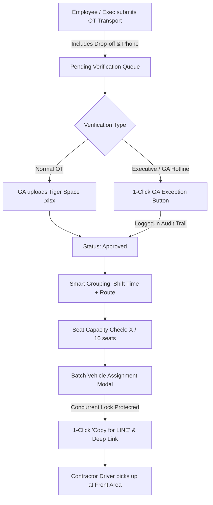

# Plan 01: Overtime (OT) Transport Workflow

> **Priority**: 🔴 **Priority 1 (Start First)**
> **Status**: ✅ **Completed**
> **Scope**: Strict focus on Overtime Transport (100% factory employee OT logistics)

---

## 1. Context & Business Reality

- **No In-House Drivers**: TOKIN hires contractor vans per trip/batch based on daily OT headcounts.
- **LINE Dispatch**: GA coordinates with contractor drivers via LINE chat by sending route, stop order, passenger headcount, and passenger phone numbers.
- **No Driver App / No QR Check-in**: Drivers check destinations and drop-offs themselves from the LINE message.
- **Executive Privilege**: Executives work late without logging OT in Tiger OpenSpace. GA knows this and requires a 1-click verification bypass.
- **Tight Cutoff Window**: Normal bookings close at 15:30. Vans depart at fixed shift times (e.g., 16:45, 19:00, 20:00, 22:00).

---

## 2. Target Workflow Stages



---

## 3. Detailed Work Packages

### Package 1.1: Passenger Contact & Executive Booking Experience

- **File**: `components/public-overtime-request-form.tsx`
- Add **Contact Phone Number** field with validation (Thai mobile format `08x-xxx-xxxx`). Pre-fill if known from employee directory.
- Store passenger phone in `OvertimeEmployee` and `Booking` records.
- Ensure frictionless submission for executives and staff without confusing validation errors or excessive disclaimers.

### Package 1.2: Tiger Space Verification & Executive 1-Click Bypass

- **File**: `components/tiger-space-report-import.tsx`
- For rows marked `not_found` (unlisted executives or direct telephone requests to GA):
  - Add inline button: **"⚡ อนุมัติข้อยกเว้น / ผู้บริหาร (Executive / GA Exception)"**
  - Instantly updates booking:
    - `status: "approved"`
    - `otVerificationStatus: "verified"`
    - `otVerificationMode: "manager_exception"`
    - `otVerifiedAt: ISO timestamp`
    - `otVerificationNote: "อนุมัติข้อยกเว้นโดย GA (Executive / Internal authorization)"`
- Add batch action: "Approve All Unmatched as GA Exception" with confirmation.
- Record actor identity (GA admin user ID/name) to audit trail.

### Package 1.3: Shift-Aware Smart Grouping & Seat Capacity Meter

- **File**: `lib/smart-grouping.ts` & `components/admin-batch-assignment-modal.tsx`
- Partition OT requests by: `Date + Shift End Time (e.g. 16:45, 19:00, 20:00, 22:00) + Route/Destination`.
- Van capacity tracking:
  - Standard Van Capacity: 10 seats (configurable 10-12).
  - Visual Seat Occupancy Bar:
    - 🟢 Green: `1-9 / 10 Seats` (Available)
    - 🟡 Amber: `10 / 10 Seats` (Full)
    - 🔴 Red: `11+ / 10 Seats` (Overflow warning)

### Package 1.4: LINE Dispatch Formatter & Contractor Tracking

- **File**: `components/admin-batch-assignment-modal.tsx` & `components/booking-table.tsx`
- Fields in Modal:
  - Contractor / Van Service Name (e.g. "หจก. นครหลวงยานยนต์", "พี่สมควร รถตู้").
  - Trip Rate (THB) for contractor billing.
  - Driver Name & Mobile Phone Number.
- **1-Click "Copy for LINE" (คัดลอกส่ง LINE)** button with clean Thai formatting:

  ```text
  🚐 ใบสั่งงานรถตู้ OT - TOKIN TRANSPORT
  ━━━━━━━━━━━━━━━━━━━
  📅 วันที่: 07/09/2026
  ⏰ เวลารถออก: 20:00 น.
  📍 จุดขึ้นรถ: หน้าบริษัท (Front Area)
  🏁 สาย/เส้นทาง: สายโรจนะ - วังน้อย
  🚐 ทะเบียน: 1กข-9999 (คนขับ: พี่สมควร 081-234-5678)
  👥 จำนวน: 4 ท่าน (ว่าง 6 ที่นั่ง)

  รายชื่อผู้โดยสารและจุดลงรถ:
  1. คุณสมชาย (PE) - 081-111-2222 ➔ ลง: ปากทางโรจนะ
  2. คุณวิภา (QA) - 082-333-4444 ➔ ลง: ตลาดคานหาม
  3. คุณประเสริฐ (MD) - 089-555-6666 ➔ ลง: โลตัสโรจนะ
  4. คุณกมล (EE) - 086-777-8888 ➔ ลง: ปั๊ม ปตท. วังน้อย
  ━━━━━━━━━━━━━━━━━━━
  *คนขับกรุณาตรวจสอบรายชื่อและโทรติดต่อผู้โดยสารหากไม่พบที่จุดนัดพบ*
  ```

- **"Open LINE Chat" (เปิดแอป LINE)** button using `https://line.me/R/msg/text/?...`.

### Package 1.5: Real-Time Cutoff Countdown & Auto-Lock (Enterprise Resilience)

- **Files**: `components/public-overtime-request-form.tsx`, `lib/request-window.ts`, `app/api/v1/bookings/route.ts`
- Visible **Cutoff Countdown Banner** on submission screens:
  - e.g., *"⚠️ การจองรถตู้ OT สำหรับวันนี้จะปิดรับคำขอในอีก 28 นาที (15:30 น.)"*
- **Server-side Cutoff Enforcement**:
  - API rejects new OT bookings submitted after 15:30 for the current date unless submitted with a GA privileged override.
  - Prevents late submissions bypassing the UI after vans are dispatched.

### Package 1.6: Concurrent Assignment Guard & Double-Allocation Prevention

- **Files**: `components/admin-batch-assignment-modal.tsx`, `supabase/migrations/`
- Guard against multiple GA administrators assembling vans concurrently at 15:35:
  - If a passenger has already been assigned to a van batch in another session, UI detects this and flags: *"ผู้โดยสารท่านนี้ถูกจัดลงรถตู้คันอื่นแล้วโดย [Admin Name]"*.
  - Backend utilizes atomic assignment transaction to prevent race conditions.

---

## 4. Acceptance Criteria

1. Employee can submit OT request with phone number and drop-off bus stop.
2. Real-time countdown banner displays cutoff status; bookings past 15:30 are rejected at API layer unless GA override is present.
3. GA can approve unmatched executive requests with 1 click; action is saved to audit log with actor ID.
4. Groups are formed by exact shift end time + route, showing seat capacity (e.g. 7/10 seats) with overflow warnings.
5. GA can assign contractor van details and copy formatted LINE dispatch message in 1 click.
6. Double-allocation protection prevents the same passenger from being assigned to multiple vans.
7. All automated type checks and unit tests pass with 0 errors.
