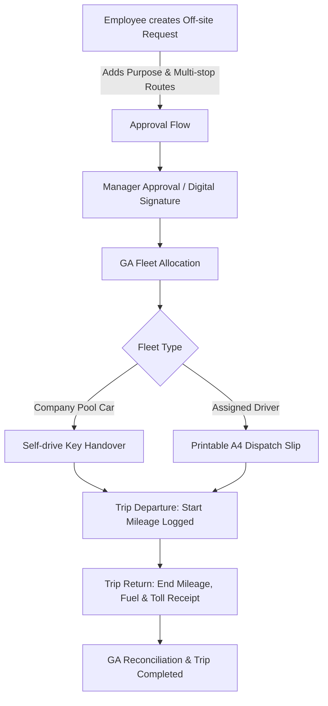

# Plan 03: Off-site Business Transport Workflow

> **Priority**: 🔵 **Priority 3**
> **Status**: ✅ **Completed**
> **Scope**: Official company business trips, customer visits, supplier audits, airport pickups
> **Verification**: 100% Typecheck passed, Vitest suites (11/11 tests passed)

---

## 1. Context & Business Reality

- **Official Business Usage**: Used by engineers, managers, and sales teams visiting customers (e.g. Amata, Bangkadi, BKK, Chonburi) or government agencies.
- **Multi-stop Itineraries**: Often involves complex routes (e.g. TOKIN Factory ➔ Subcontractor Plating Plant ➔ Customer Factory ➔ TOKIN).
- **Formal Approval Hierarchy**: Off-site trips require departmental manager approvals based on position tier:
  - Chief ➔ Supervisor ➔ Sect. Manager ➔ Dept. Manager ➔ AGM up.
- **Physical Handover & Log Sheet**: Requires physical vehicle key handover and odometer/fuel/toll tracking upon return.

---

## 2. Key Workflow Stages

---

## 3. Planned Work Packages

### Package 3.1: Multi-Stop Routing & Google Maps Estimation

- **Files**: `components/public-car-service-request-form.tsx`, `components/multi-stop-destination-field.tsx`
- Interactive multi-stop builder (Origin ➔ Stop 1 ➔ Stop 2 ➔ Destination).
- Google Maps route preview and estimated travel duration to avoid scheduling conflicts.

### Package 3.2: Multi-Tier Department Approver Matrix

- **Files**: `components/public-approve-request.tsx`, `lib/business.ts`
- Clean approval dashboard with position-based routing (`Supervisor`, `Sect.Manager`, `Dept.Manager`, `AGM.up`).
- Urgent trip flagging with priority push notifications to department heads.

### Package 3.3: Digital Check-out & Check-in Mileage / Expense Log

- **Files**: `components/driver-dispatch-slip-modal.tsx`, `components/booking-detail.tsx`
- Digital mileage capture (Odometer before departure, Odometer on return, calculated total km).
- Toll fee, fuel slip, and parking expense attachment.
- Automatic calculation of fuel efficiency (km/liter) and cost per kilometer.

---

## 4. Dependencies & Prerequisite

- **Strict Prerequisite**: Plan 01 (OT Transport Workflow) must be fully completed and accepted before initiating implementation of this plan.
