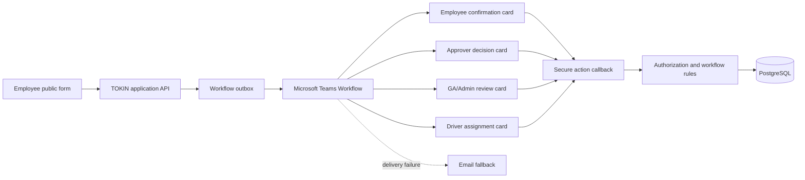

# Plan 08: Teams-First Workflow Without Microsoft Application Login

> Status: Planned
> Decision: Remove Microsoft OAuth from the TOKIN web application. Use Microsoft Teams Workflows for identity-aware notifications and simple actions, while retaining authenticated access for privileged administration.
> Delivery rule: Complete each phase's exit gate before starting the next phase.

## 1. Outcome

Deliver a public-facing transport request system that is simple for employees to use without a web application account, while keeping approvals, dispatch, personal data, and administrative actions secure and auditable.

The intended operating model is:



## 2. Fixed Architecture Decisions

1. Employees and approvers do not sign in to the TOKIN web application.
2. Microsoft OAuth and the Azure/Entra application-login dependency are removed from the user journey.
3. Teams identity is used when a Teams card response is available, but the backend remains the final authorization authority.
4. GA administrators, finance users, and auditors retain authenticated accounts. Initial authentication remains Supabase email/password; MFA should be enabled where supported.
5. Email remains a fallback channel. Teams is not the only recovery path.
6. Complex work stays in the web application. Teams cards provide summaries and safe, small actions.
7. PostgreSQL owns workflow state, constraints, concurrency protection, and the audit trail.
8. Workflow URLs, callback secrets, and service-role credentials are server-side secrets only.
9. C# is an optional later evolution, not a prerequisite for this workflow.

## 3. Access Model

| Audience | Web login | Primary access | Permitted actions |
| --- | --- | --- | --- |
| Employee/requester | No | Public form and Teams confirmation | Submit, confirm, view, edit, cancel own request |
| Department approver | No | Teams decision card or expiring secure link | Review, approve, reject, request changes |
| GA/Admin | Yes | Authenticated web workspace plus Teams alerts | Verify, review, plan, assign, override, cancel |
| Driver | No in first release | Teams card or expiring assignment link | Accept, view route, report a problem |
| Finance | Yes | Authenticated reports | Review billing and export data |
| Auditor | Yes | Authenticated read-only workspace | Review audit and compliance records |

The public site must never expose admin, finance, audit, employee-directory, or cross-employee booking data.

## 4. Teams Action Design

| Event | Recipient | Card actions | Action type |
| --- | --- | --- | --- |
| Request submitted | Employee | Confirm request, Edit request, Cancel request | Confirm can be direct; edit opens a signed web page |
| Approval requested | Assigned approver | Review, Approve, Reject, Request changes | Decision can be direct; review opens a signed web page |
| OT ready for verification | GA/Admin | Review OT, Open dispatch board | Web action in the first release |
| Request approved | GA/Admin | Review, Open planning | Web action |
| Assignment completed | Employee | View assignment, Download PDF | Secure web actions |
| Assignment offered | Driver | Accept, View route, Report issue | Accept can be direct; details use secure web pages |
| Trip ready/completed | GA/Admin | Open trip, Review completion | Web action |

Direct assignment from a Teams card is excluded from the first release. Assignment requires current availability, conflict checks, passenger grouping, and transaction-safe resource allocation; those tasks remain in the GA web workspace.

## 5. Workflow State Model

The final state names may be refined during implementation, but the state machine must express these business stages explicitly:

```text
Draft
  -> PendingRequesterConfirmation
  -> PendingApproval | PendingOtVerification
  -> ReadyForPlanning
  -> Assigned
  -> InProgress
  -> Completed

Terminal/exception paths:
Rejected | Cancelled | ChangesRequested | Expired
```

Only named business commands may transition state. Generic client-side status updates are not permitted.

Initial command set:

- `submit_request`
- `confirm_requester`
- `request_changes`
- `decide_request`
- `verify_ot_request`
- `assign_transport`
- `accept_assignment`
- `start_trip`
- `complete_trip`
- `cancel_request`

## 6. Delivery Phases

| Phase | Focus | Must finish before |
| --- | --- | --- |
| 0 | Preserve and baseline | Any structural change |
| 1 | Security and database foundation | Public deployment or Teams actions |
| 2 | Remove Microsoft application login safely | No-login user rollout |
| 3 | Command, callback, outbox, and audit backbone | Interactive Teams actions |
| 4 | Single-approver Teams proof of concept | Additional Teams audiences |
| 5 | Employee, admin, and driver Teams rollout | Broad operational adoption |
| 6 | Simplified employee and GA web experience | Production acceptance |
| 7 | E2E, CI, deployment, backup, and monitoring | Public production release |
| 8 | Optional evidence-based C# decision | Any backend migration |

### Phase 0: Preserve and Baseline

Purpose: establish a recoverable starting point and prove what currently works.

Deliverables:

- Preserve all current uncommitted work in a reviewed snapshot branch or commit.
- Record the current Node, Next.js, Supabase CLI, database, and deployment versions.
- Inventory environment variables and external workflow dependencies without recording secret values.
- Create separate local/staging/production environment definitions.
- Run typecheck, unit tests, production build, and dependency audit.
- Document current workflows and all public/protected routes.
- Export or back up existing production data before applying database migrations.

Exit gate:

- The current revision can be rebuilt and restored.
- No secret is committed to Git.
- Existing test/build results are recorded.

### Phase 1: Security and Database Foundation

Purpose: make the database migration chain and public attack surface safe before connecting Teams actions.

Deliverables:

- Upgrade Next.js and React to current security-patched stable releases.
- Apply the complete migration chain to a new empty database in CI and staging.
- Correct `active` versus `is_active` schema mismatches.
- Rebuild archival around the complete booking aggregate rather than nonexistent JSON columns.
- Define one database role model that includes every supported application role.
- Remove authorization decisions based on user-editable metadata.
- Revoke public execution from security-definer functions unless explicitly required.
- Restrict or remove the unauthenticated employee-directory function.
- Replace instance-memory rate limiting with a durable store.
- Add real database readiness checks without exposing runtime internals.
- Make production fail closed when required environment variables are absent; demo mode must require an explicit development flag.

Exit gate:

- A clean database can be created from migrations without manual correction.
- Automated RLS tests prove requester, approver, admin, driver, finance, and auditor boundaries.
- Public endpoints pass abuse, data-exposure, and authorization tests.

### Phase 2: No-Microsoft-Login Access Model

> Implementation checkpoint (2026-10-22): application, Edge Function, migration, route-authorization, recovery, and runbook changes are implemented in the workspace. Typecheck and unit tests pass. The clean database replay and final browser/build verification remain gated by the current local Docker/Windows disk failure.

Purpose: remove the blocked Entra application-login dependency without removing security from privileged areas.

Deliverables:

- Remove the Microsoft sign-in button and OAuth initiation from the supported UI.
- Disable the OAuth callback route after confirming no active flow depends on it.
- Keep Supabase authentication for privileged roles.
- Add admin account provisioning and recovery procedures.
- Introduce `PendingRequesterConfirmation` or an equivalent confirmation record.
- Require company email-domain validation for employee requests.
- Do not return requester manage tokens or manage URLs in public submission responses.
- Deliver manage access only through the verified Teams/email channel.
- Keep public, signed-link, and authenticated routes clearly separated.

Exit gate:

- Employees can submit without a web login.
- An anonymous submitter cannot manage a request without receiving the Teams/email message.
- Admin and reporting routes reject anonymous users and incorrect roles.

### Phase 3: Workflow Command and Notification Backbone

> Implementation checkpoint (2026-10-22): the approval command, optimistic
> workflow version, idempotent action evidence, transactional outbox, leased
> retry worker, delivery-attempt history, sanitized admin overview, and versioned
> Teams callback contract are implemented in the workspace. Unit/type checks can
> run locally; clean database replay remains gated by the current Docker/disk
> failure and is enforced in CI with dedicated pgTAP coverage.

Purpose: ensure Teams is a delivery channel, not the owner of business state.

Deliverables:

- Replace generic booking updates with explicit command endpoints or database functions.
- Define versioned request/response DTOs for every command.
- Add optimistic concurrency or expected-version checks to booking transitions.
- Add a transactional workflow outbox.
- Add delivery-attempt records with status, retry count, workflow run ID, timestamps, and sanitized error details.
- Add action records with a unique idempotency key.
- Validate callback signature/secret, event type, booking ID, action, current state, expiration, and actor.
- Compare the real Teams responder email/user ID with the booking's assigned approver or authorized admin directory.
- Return an idempotent success result for already-processed actions.
- Add an email fallback policy and notification timeout policy.

Suggested tables:

- `workflow_outbox`
- `workflow_deliveries`
- `workflow_actions`
- `workflow_actor_mappings` only if a stable Teams-to-employee mapping is required

Exit gate:

- Retrying a webhook or double-clicking a card cannot duplicate a state change.
- A forwarded card or forged approver email cannot authorize an action.
- Failed deliveries are visible and safely retryable.

### Phase 4: Teams Proof of Concept - Approval Only

> Completed (2026-10-24): all 12 tenant-connected staging scenarios passed,
> including mobile rendering, approve/reject/request changes, idempotent retry,
> wrong actor, stale/expired card, timeout fallback, and card replacement. The
> flow has a trusted co-owner and sanitized evidence is recorded in
> `docs/test-results/PHASE4-STAGING-2026-10-24.md`.

Purpose: validate company tenant permissions and the end-to-end security model before creating every card.

Scope:

- One staging workflow.
- One assigned approver.
- One Adaptive Card with Review, Approve, Reject, and Request changes.
- A mandatory comment for rejection and change requests.
- Card replacement after a response.
- Backend validation and audit entry.
- Email fallback for delivery failure or timeout.

Operational prerequisites:

- Confirm the Teams Workflows app is available to the workflow owner.
- Confirm the owner can use the Teams connector and required webhook trigger.
- Assign at least one trusted co-owner.
- Store the workflow endpoint and callback secret in server-side secrets.
- Document how to rotate the workflow URL and secret.

Exit gate:

- At least ten repeated staging scenarios pass, including approve, reject, request changes, duplicate click, wrong actor, stale card, timeout, and workflow retry.
- Workflow ownership and recovery are documented.
- No application service-role credential exists in Power Automate.

If the tenant blocks interactive cards, use notification cards with secure `OpenUrl` actions and continue with email fallback. This fallback does not block the rest of the project.

### Phase 5: Expand Teams Notifications and Driver LINE Dispatch

> Implementation checkpoint (2026-10-24): the shared mobile-safe Adaptive Card
> library and versioned requester envelope are implemented for confirmation,
> decision status, and assignment notifications. The requester-manage,
> assignment, and GA/Admin tenant flows are Teams-first with email fallback,
> and controlled tests to `phooriwat.pungpech@yageo.com` passed. GA/Admin events
> are transactionally fanned out to a privacy-minimized outbox payload. Drivers
> do not use Teams: GA now prepares and manually sends a reviewed Thai dispatch
> through LINE after saving the assignment, with privacy-minimized copy, open,
> and human-confirmed sent audit metadata. The protected outbox worker is now
> scheduled in GitHub Actions every five minutes and its manual production run
> passed. Permanent Power Automate client errors are quarantined immediately.
> Reminder and escalation rollout and the final GA-to-driver LINE chat test
> remain gated.

Purpose: roll out proven templates without creating one large, fragile flow.

Deliverables:

- Employee request-confirmation card.
- Approver decision card.
- GA/Admin review and exception alerts.
- Assignment confirmation card for the employee.
- GA-controlled LINE dispatch for contractor drivers without Microsoft Teams.
- Reminder and escalation messages for unconfirmed or unanswered items.
- Shared card template versioning and a test-payload library.
- Consistent success, already-processed, expired, and error messages.

Exit gate:

- Every card event has an owner, timeout, fallback, audit record, and support procedure.
- Personally identifiable information is minimized for each audience.
- Cards remain concise and usable on Teams mobile.

### Phase 6: Simplify Web UI and Operational Flow

> Implementation checkpoint (2026-10-24): Batch 1 adds a mobile-first employee
> tracking entry, secure-link recovery guidance, and a shared request status
> timeline with clear next actions. The signed management token remains the
> authorization boundary; request-number lookup is intentionally not exposed.
> Typecheck, focused tests, and desktop/mobile browser verification pass.
> Batch 1.1 adds the TOKIN Thailand photographic hero, floating three-service
> action panel, operational benefits, request-to-trip guide, and prominent GA
> support while preserving all existing backend and workflow contracts.
> Batch 1.2 extends that visual language to every route family through shared
> public, authentication, and authenticated workspace shells. Page headers,
> navigation, cards, buttons, Material UI surfaces, and mobile behavior now use
> one TOKIN blue/yellow system; all 90 tests and the 33-page production build
> pass without changing workflow or authorization rules.
> Batch 2 starts the GA operational simplification with one canonical queue:
> Needs review, Ready to plan, Assigned, In progress, and Completed. Summary
> cards deep-link into each stage, row actions reflect the next task, and batch
> assignment plus smart grouping are restricted to genuinely approved requests.
> Typecheck, 95 tests, and the 33-page production build pass.
> Batch 2.2 moves that queue to authenticated server pagination and filtering,
> adds authoritative stage totals, and exposes the existing admin-only workflow
> exception retry control. The GA page now matches the home page through the
> same facility image, blue overlay, amber action, and floating queue cards.
> Typecheck, 98 tests, and the 33-page production build pass.

Purpose: make the web application easy for occasional employees and fast for daily GA operation.

Employee experience:

- One landing page with two clear choices: OT Transport and Off-site Business Trip.
- Auto-populate known employee details only after a verified identity/channel lookup.
- Show only fields relevant to the selected request type.
- Provide a clear confirmation and expected next step.

GA/Admin experience:

- One queue organized as Needs Review, Ready to Plan, Assigned, In Progress, and Completed.
- Server-side filtering, pagination, and aggregate counts.
- Batch OT grouping and conflict-safe assignment.
- Visible failed-notification and exception queues.

Technical cleanup:

- Use one API/domain mapping contract instead of mixing raw database rows with UI models.
- Remove full-table loading from the application provider.
- Standardize the visual system and responsive behavior.
- Ensure keyboard, contrast, loading, empty, and error states are complete.

Exit gate:

- Representative employee and GA users complete critical tasks without instruction.
- Counts and search remain correct beyond ten and one hundred records.
- Mobile Teams-to-web navigation is tested.

### Phase 7: Automated Quality and Deployment

Purpose: establish a repeatable public deployment with measurable operational safety.

Deliverables:

- Install and pin Playwright test tooling.
- Add E2E tests for public submission, Teams callback, approval, assignment, cancellation, and expired/stale actions.
- Add migration and RLS integration tests using an isolated database.
- Run typecheck, unit, integration, E2E, dependency, and build checks in CI.
- Add secret scanning and migration linting.
- Deploy a staging environment before production.
- Add CSP, HSTS at the hosting layer, secure headers, log redaction, and request correlation IDs.
- Add uptime checks, real readiness monitoring, backup/export automation, and a restore exercise.
- Document free-tier quotas and the service-degradation procedure.

Exit gate:

- A deployment can be reproduced from Git and environment configuration.
- The backup restoration exercise succeeds.
- Critical workflow E2E tests pass against staging.
- The business owner explicitly accepts free-tier availability and backup limitations before public production use.

### Phase 8: Optional C# Decision After Pilot

Purpose: decide from operational evidence rather than rewriting preemptively.

Adopt ASP.NET Core only if one or more conditions are true:

- The company has a supported .NET hosting environment and maintainers.
- Integration/background-job complexity has outgrown Edge Functions.
- A stable API is needed by multiple applications.
- Organizational security or support standards require .NET.
- A production hosting budget exists.

If adopted:

- Keep Next.js and TypeScript for the frontend.
- Keep PostgreSQL and the existing data model where practical.
- Introduce an ASP.NET Core modular monolith behind versioned APIs.
- Move one module at a time using the strangler pattern.
- Keep exactly one migration authority for each database schema.
- Do not perform a big-bang rewrite.

## 7. Testing Matrix

Every state-changing Teams action must test:

- Correct recipient and correct action.
- Wrong user or forwarded card.
- Expired action.
- Duplicate response.
- Workflow retry.
- Request already changed in the web application.
- Missing or invalid callback secret.
- Invalid action for current state.
- Database or network failure.
- Audit record creation.
- Notification failure and email fallback.

## 8. Audit Requirements

Each accepted or rejected workflow action records:

- Booking ID and request number.
- Action and previous/new state.
- Actual responder Teams ID and email when supplied by the connector.
- Expected actor or role.
- Workflow name, version, run ID, and card/action ID.
- Idempotency key.
- Response comments.
- Timestamp and correlation ID.
- Validation result for rejected callback attempts, without storing secrets.

## 9. Rollback and Continuity

- Teams actions are controlled by feature flags per audience and action type.
- Disabling direct Teams actions leaves secure web links and email fallback available.
- Database migrations are forward-only and tested before production.
- A failed Teams workflow must not corrupt or partially transition a booking.
- The web application remains the operational source of truth.
- Every production workflow has a co-owner and an owner-recovery procedure.

## 10. Explicitly Out of Scope for the First Release

- A custom Teams bot or Teams application package.
- Microsoft Entra application login for the TOKIN website.
- Direct complex vehicle/driver assignment inside a Teams card.
- Microservices.
- A full C# rewrite.
- A claim that free hosting provides an enterprise SLA, guaranteed backups, or guaranteed uptime.

## 11. Recommended First Implementation Batch

Begin only with Phases 0 and 1. Do not build Teams cards until the database migration chain, public endpoints, framework security version, RLS boundaries, and production fail-closed behavior are verified.

The first batch is complete when:

1. The current work is recoverable.
2. The application builds and tests on CI.
3. A fresh database can be created entirely from migrations.
4. Public data exposure is closed.
5. Authorization tests pass at the database boundary.

After that gate, implement Phase 2 and the single-approver Phase 4 proof of concept through the Phase 3 command/outbox foundation.

## 12. Microsoft Platform References

- [Adaptive Cards for Microsoft Teams in Power Automate](https://learn.microsoft.com/power-automate/overview-adaptive-cards)
- [Create flows that post Adaptive Cards to Microsoft Teams](https://learn.microsoft.com/power-automate/create-adaptive-cards)
- [Send messages in Teams using incoming webhooks](https://support.microsoft.com/workflows/send-messages-in-teams-using-incoming-webhooks)
- [Teams Workflow webhook limitations and ownership](https://learn.microsoft.com/microsoftteams/platform/webhooks-and-connectors/how-to/add-incoming-webhook)

Tenant availability, connector policy, licensing, and workflow ownership must be confirmed during Phase 4 rather than assumed from development access.
