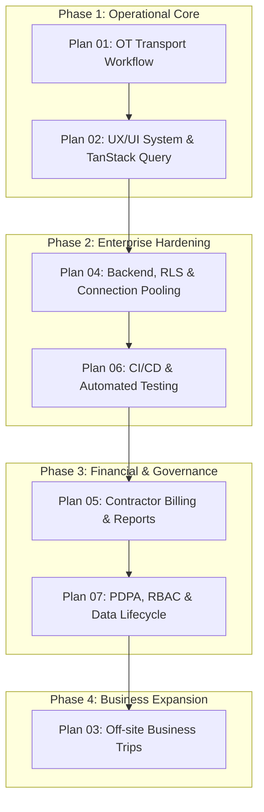

# 📋 TOKIN Car Service — Master Enterprise Implementation Plans

> **Version**: 2.0 (Enterprise Grade)
> **Target Standard**: ISO 9001 / IATF 16949 Compliance, PDPA Ready, Zero-Downtime Peak 15:30 Handling
> **Repository**: `TOKIN-Car-Service`

---

## 🗺️ Master Plan Index & Priority Sequence

| Plan # | Document                                                                         | Priority |  Phase  | Core Value                                                                                    |         Status         |
| :----: | -------------------------------------------------------------------------------- | :------: | :-----: | --------------------------------------------------------------------------------------------- | :--------------------: |
| **01** | [01-OT-TRANSPORT-WORKFLOW.md](./01-OT-TRANSPORT-WORKFLOW.md)                     |  🔴 P1   | Phase 1 | 100% factory employee OT logistics, 15:30 cutoff, 1-Click Executive bypass, LINE dispatch     |       ✅ **Completed**       |
| **02** | [02-UX-UI-DESIGN-SYSTEM.md](./02-UX-UI-DESIGN-SYSTEM.md)                         |  🟡 P2   | Phase 1 | Modern enterprise UI tokens, TanStack Query decoupling (eradicate God-state), mobile/tablet   |       ✅ **Completed**       |
| **03** | [03-OFF-SITE-TRANSPORT-WORKFLOW.md](./03-OFF-SITE-TRANSPORT-WORKFLOW.md)         |  🔵 P3   | Phase 1 | Off-site business trips, multi-stop routing, approval hierarchy, digital odometer check-in    |       ✅ **Completed**       |
| **04** | [04-BACKEND-SECURITY-INFRASTRUCTURE.md](./04-BACKEND-SECURITY-INFRASTRUCTURE.md) |  🟢 P4   | Phase 2 | Supabase connection pooling (port 6543), RLS hardening, idempotency keys, yearly sequence     |       ✅ **Completed**       |
| **06** | [06-OBSERVABILITY-TESTING-CICD.md](./06-OBSERVABILITY-TESTING-CICD.md)           |  🟠 P5   | Phase 2 | Vitest unit tests, Playwright E2E flows, GitHub Actions CI/CD, `/api/health` monitoring       |       ✅ **Completed**       |
| **05** | [05-CONTRACTOR-BILLING-AND-REPORTS.md](./05-CONTRACTOR-BILLING-AND-REPORTS.md)   |  🟣 P6   | Phase 3 | Contractor billing ledger, departmental cost centers (PE/QA/TA), 1-click Finance Excel export |       ✅ **Completed**       |
| **07** | [07-GOVERNANCE-PDPA-DATA-LIFECYCLE.md](./07-GOVERNANCE-PDPA-DATA-LIFECYCLE.md)   |  🛡️ P7   | Phase 3 | PDPA PII masking, Enterprise RBAC matrix, 90-day hot / 3-year cold archival, DRP fallback     |       ✅ **Completed**       |

---

## 🏗️ Architecture & Execution Flow

---

## 🎯 Guiding Principles for Implementation

1. **Factory Floor First**: Designs and workflows must prioritize speed for factory floor supervisors and GA dispatchers operating in high-pressure cutoff windows.
2. **Zero In-House Driver Myth**: System reflects business reality — contractor vans hired per batch, communicated via LINE, with no driver app or QR check-in required.
3. **Data Integrity & Auditability**: Every approval, exception bypass, and vehicle assignment creates an immutable audit record.
4. **Resilience over Complexity**: Offline safety nets ensure that factory employees never miss transport home even during network disruptions.
